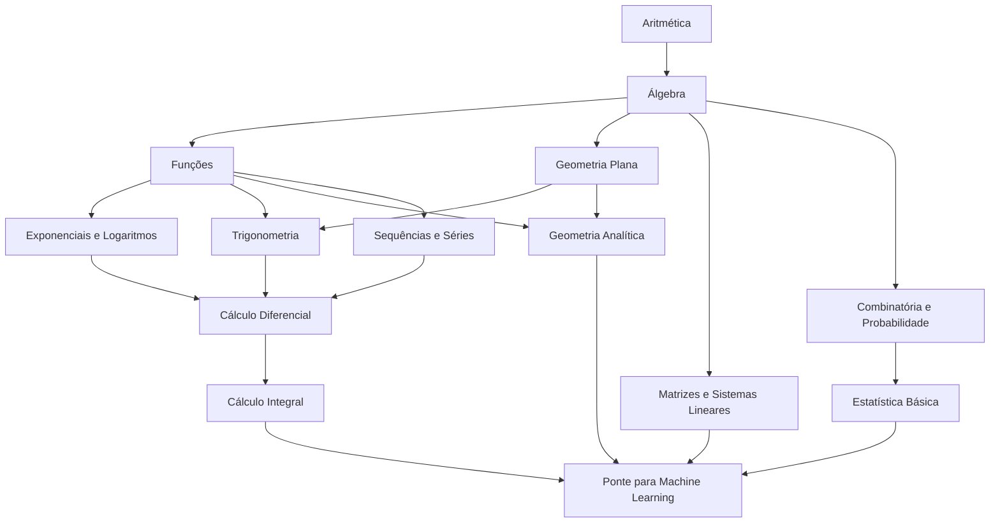

# 🗺️ Mapa da Matemática

A trilha completa, da aritmética à base para machine learning. Cada seta significa "**precisa de**": não comece um tema antes de dominar os que apontam para ele.

> [!tip] Os blocos do diagrama são clicáveis.

---

## Fase 1 · Fundamentos (o que a escola deveria ter deixado sólido)

| # | Tema | Situação |
|---|---|---|
| 01 | [[Aritmética]] | 📘 Conteúdo completo |
| 02 | [[Álgebra]] | 📘 Conteúdo completo |

## Fase 2 · Pré-cálculo (ensino médio)

| # | Tema | Situação |
|---|---|---|
| 03 | [[Funções]] | 📝 Esboço |
| 04 | [[Exponenciais e Logaritmos]] | 📝 Esboço |
| 05 | [[Geometria Plana]] | 📝 Esboço |
| 06 | [[Trigonometria]] | 📝 Esboço |
| 07 | [[Geometria Analítica]] | 📝 Esboço |
| 08 | [[Sequências e Séries]] | 📝 Esboço |

## Fase 3 · Cálculo

| # | Tema | Situação |
|---|---|---|
| 09 | [[Cálculo Diferencial]] | 📝 Esboço |
| 10 | [[Cálculo Integral]] | 📝 Esboço |

## Fase 4 · Matrizes, probabilidade e estatística

Dependem só de [[Álgebra]], então dá para estudá-los **em paralelo** com as fases 2 e 3 (por exemplo, um tema de pré-cálculo e um destes ao mesmo tempo).

| # | Tema | Situação |
|---|---|---|
| 11 | [[Matrizes e Sistemas Lineares]] | 📝 Esboço |
| 12 | [[Combinatória e Probabilidade]] | 📝 Esboço |
| 13 | [[Estatística Básica]] | 📝 Esboço |

## Fase 5 · Ponte para Machine Learning

| # | Tema | Situação |
|---|---|---|
| 14 | [[Ponte para Machine Learning]] | 📝 Esboço |

> [!info] 📝 Esboço?
> Os temas em esboço já têm uma pasta para cada conceito, com uma nota curta dizendo o que estudar ali. Quando chegar a vez deles, gere o conteúdo completo seguindo [[Como Gerar Conteúdo]].

---

## Por que essa ordem leva ao machine learning

Quase todo algoritmo de ML é uma combinação de quatro coisas:

- **Álgebra linear** (vetores e matrizes): os dados e os pesos de um modelo são matrizes. Base: [[Sistemas de Equações]] → [[Matrizes e Sistemas Lineares]] → [[Ponte para Machine Learning]].
- **Cálculo** (derivadas e gradiente): um modelo "aprende" descendo pelo gradiente do erro. Base: [[Funções]] → [[Cálculo Diferencial]].
- **Probabilidade e estatística**: modelos lidam com incerteza, distribuições e médias. Base: [[Combinatória e Probabilidade]] → [[Estatística Básica]].
- **Exponenciais e logaritmos**: aparecem em softmax, log-loss, cross-entropy e taxas de aprendizado. Base: [[Potenciação]] → [[Exponenciais e Logaritmos]].

E tudo isso se apoia em **frações, potências, manipulação algébrica e notação** (como o [[Somatório e Produtório|somatório Σ]]). É por isso que as fases 1 e 2 são tão importantes.

---

## Extras opcionais (não são necessários para ML)

Fazem parte do currículo escolar, mas podem ficar para depois: números complexos, geometria espacial avançada e matemática financeira avançada. Se quiser estudá-los, é só criar a pasta seguindo o mesmo padrão.
