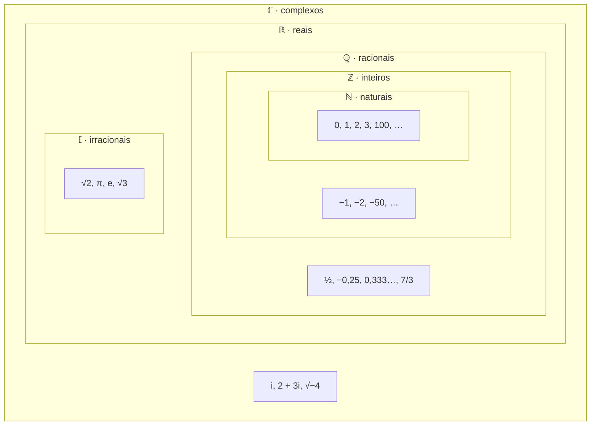
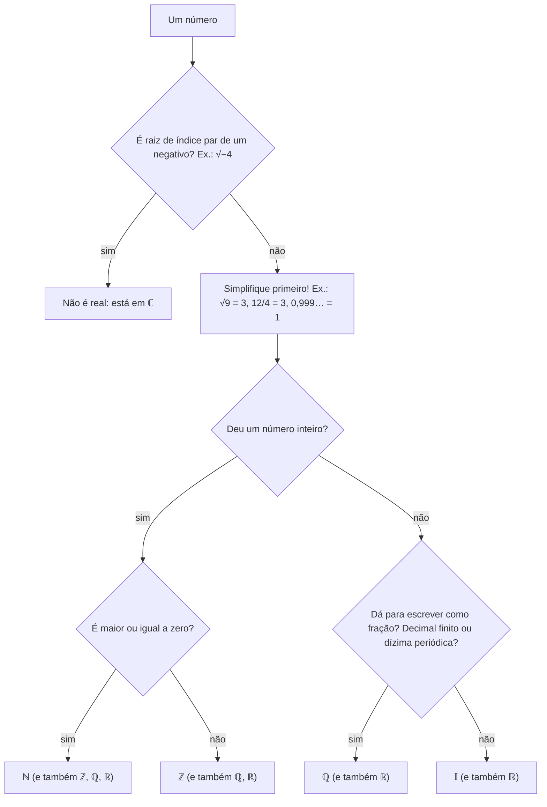

# 🔢 Conjuntos Numéricos: Guia Completo

> [!abstract] A ideia em uma frase
> Cada conjunto numérico foi criado para resolver uma conta que o conjunto anterior **não conseguia resolver**. Eles se encaixam um dentro do outro, como bonecas russas: $\mathbb{N} \subset \mathbb{Z} \subset \mathbb{Q} \subset \mathbb{R} \subset \mathbb{C}$.

**Nota do conceito:** [[Conjuntos Numéricos]] · **Praticar:** [[Conjuntos Numéricos - Exercícios]] · **Tema:** [[Aritmética]]

> [!info] Como usar esta nota
> A nota [[Conjuntos Numéricos]] é a versão de estudo, com etapas e exercícios. Este guia é a **referência completa**: a história de cada conjunto, as notações, um passo a passo para classificar qualquer número, curiosidades e um resumo para copiar no caderno.

---

## 1. O mapa



Repare em duas coisas:
- Cada conjunto **contém** os anteriores: todo natural é inteiro, todo inteiro é racional, e assim por diante.
- Os **irracionais** ficam do lado de fora dos racionais. Um número **não pode** ser racional e irracional ao mesmo tempo. Juntos, os dois formam os reais.

---

## 2. A história: cada conjunto resolve uma equação

Essa é a melhor forma de entender **por que** cada conjunto existe.

| Equação | Em quem ela **não** tem solução | Solução | Conjunto que a resolve |
|---|---|---|---|
| $x + 3 = 5$ | resolve em todos | $x = 2$ | $\mathbb{N}$ |
| $x + 5 = 3$ | $\mathbb{N}$ (não existe natural que somado a 5 dê 3) | $x = -2$ | $\mathbb{Z}$ |
| $3x = 2$ | $\mathbb{Z}$ (não existe inteiro que vezes 3 dê 2) | $x = \frac{2}{3}$ | $\mathbb{Q}$ |
| $x^2 = 2$ | $\mathbb{Q}$ (nenhuma fração ao quadrado dá 2) | $x = \pm\sqrt{2}$ | $\mathbb{R}$ |
| $x^2 = -1$ | $\mathbb{R}$ (nenhum real ao quadrado é negativo) | $x = \pm i$ | $\mathbb{C}$ |

> [!tip] Leia de cima para baixo
> A cada linha, uma operação que "não fechava" passa a fechar: primeiro a **subtração**, depois a **divisão**, depois a **raiz de positivos** e, por fim, a **raiz de negativos**.

---

## 3. Cada conjunto em detalhe

### ℕ · Naturais: contar

$$\mathbb{N} = \{0, 1, 2, 3, 4, \dots\}$$

- São os números de **contar** (quantos alunos, quantas maçãs).
- No Brasil, a convenção escolar **inclui o zero**. Sem o zero, escreve-se $\mathbb{N}^* = \{1, 2, 3, \dots\}$.
- Têm um **menor elemento** (o 0) e todo natural tem um **sucessor** ($n + 1$).
- São **discretos**: entre 2 e 3 não há nenhum outro natural.
- Fecham para **soma** e **multiplicação**, mas não para subtração: $3 - 5 \notin \mathbb{N}$.

### ℤ · Inteiros: dívidas e temperaturas abaixo de zero

$$\mathbb{Z} = \{\dots, -3, -2, -1, 0, 1, 2, 3, \dots\}$$

- A letra vem do alemão ***Zahlen***, "números".
- São os naturais **mais os seus opostos** (negativos). Veja [[Números Inteiros]].
- Notações úteis: $\mathbb{Z}_+ = \{0, 1, 2, \dots\}$ (não negativos), $\mathbb{Z}_- = \{\dots, -2, -1, 0\}$ (não positivos) e $\mathbb{Z}^* = \mathbb{Z} - \{0\}$ (sem o zero).
- Continuam **discretos** e não têm menor elemento.
- Fecham para soma, subtração e multiplicação, mas não para divisão: $3 \div 4 \notin \mathbb{Z}$.

### ℚ · Racionais: dividir

$$\mathbb{Q} = \left\{ \frac{a}{b} \;\middle|\; a, b \in \mathbb{Z},\ b \neq 0 \right\}$$

- A letra vem de **quociente** (o resultado de uma divisão).
- São todos os números que se escrevem como **fração de inteiros**. Veja [[Frações e Equivalência]].
- Todo inteiro é racional: $-5 = \frac{-5}{1}$.
- Na forma decimal, um racional é sempre:
  - um **decimal finito**: $\frac{3}{4} = 0{,}75$; ou
  - uma **dízima periódica**: $\frac{1}{3} = 0{,}333\dots$ (veja [[Números Decimais]]).
- São **densos**: entre dois racionais quaisquer sempre existe outro (por exemplo, a média deles). Então entre 0 e 1 há **infinitos** racionais.
- Mesmo assim, deixam **buracos** na reta, como o ponto $\sqrt{2}$.

### 𝕀 · Irracionais: os buracos da reta

- São os números que **não** se escrevem como fração de inteiros.
- Na forma decimal, têm **infinitas casas sem período**:

| Irracional | Valor aproximado | Onde aparece |
|---|---|---|
| $\sqrt{2}$ | $1{,}41421356\dots$ | a diagonal de um quadrado de lado 1 |
| $\sqrt{3}$ | $1{,}73205080\dots$ | a altura do triângulo equilátero |
| $\pi$ | $3{,}14159265\dots$ | a circunferência dividida pelo diâmetro |
| $e$ | $2{,}71828182\dots$ | crescimento contínuo, juros compostos, ML ([[O Número e]]) |
| $\varphi = \frac{1 + \sqrt{5}}{2}$ | $1{,}61803398\dots$ | a razão áurea |

- A raiz quadrada de um natural que **não é quadrado perfeito** é sempre irracional: $\sqrt{2}, \sqrt{5}, \sqrt{8}, \sqrt{10}$… Já $\sqrt{9} = 3$ é racional.
- **Não** fecham para nenhuma operação: $\sqrt{2} \cdot \sqrt{2} = 2$ e $\sqrt{2} + (-\sqrt{2}) = 0$, que são racionais.

> [!question]- A prova de que $\sqrt{2}$ é irracional (clique para abrir)
> Suponha que $\sqrt{2} = \frac{a}{b}$, com a fração **irredutível**. Então $a^2 = 2b^2$, ou seja, $a^2$ é par, e por isso $a$ é par: $a = 2k$. Substituindo, $4k^2 = 2b^2$, ou seja, $b^2 = 2k^2$, e $b$ também é par. Mas se $a$ e $b$ são pares, a fração não era irredutível. **Contradição!** Logo, $\sqrt{2}$ não é uma fração.

### ℝ · Reais: a reta inteira

$$\mathbb{R} = \mathbb{Q} \cup \mathbb{I}$$

- São **todos os pontos da reta numérica**, sem buracos. Cada ponto é exatamente um número real.
- Fecham para soma, subtração, multiplicação e divisão (por número diferente de zero).
- Têm **ordem**: dados dois reais diferentes, um é sempre maior que o outro. É isso que permite falar em intervalos e inequações ([[Inequações do 1º Grau]]).
- Mas ainda não fecham para a raiz quadrada de negativos: $\sqrt{-4} \notin \mathbb{R}$.

```
  −3    −2    −1     0     ½    1   √2      2    e   3   π
───┼─────┼─────┼─────┼─────┼────┼────┼──────┼────┼───┼───┼──→
```

### ℂ · Complexos: um bônus (fora da trilha principal)

- Criados para dar sentido a $\sqrt{-1}$. Define-se a **unidade imaginária** $i$, com $i^2 = -1$.
- Um complexo tem a forma $a + bi$, com $a, b \in \mathbb{R}$. Exemplos: $2 + 3i$, $\;-i$, $\;5$ (que é $5 + 0i$).
- Todo real é complexo: $\mathbb{R} \subset \mathbb{C}$.
- Com eles, **toda** equação polinomial tem solução (o *Teorema Fundamental da Álgebra*). Por exemplo, $x^2 + 4 = 0$ dá $x = \pm 2i$.
- Não são necessários para a base de ML, mas aparecem em processamento de sinais (transformada de Fourier) e nos autovalores de algumas matrizes ([[Autovalores e Autovetores]]).

---

## 4. Quais operações "fecham" em cada conjunto

"Fechar" significa que o resultado continua **dentro** do conjunto.

| | Soma | Subtração | Multiplicação | Divisão (por $\neq 0$) | Raiz de positivo | Raiz de negativo |
|---|---|---|---|---|---|---|
| $\mathbb{N}$ | ✅ | ❌ $3 - 5$ | ✅ | ❌ $3 \div 4$ | ❌ $\sqrt{2}$ | ❌ |
| $\mathbb{Z}$ | ✅ | ✅ | ✅ | ❌ $3 \div 4$ | ❌ $\sqrt{2}$ | ❌ |
| $\mathbb{Q}$ | ✅ | ✅ | ✅ | ✅ | ❌ $\sqrt{2}$ | ❌ |
| $\mathbb{I}$ | ❌ | ❌ | ❌ | ❌ | ❌ | ❌ |
| $\mathbb{R}$ | ✅ | ✅ | ✅ | ✅ | ✅ | ❌ $\sqrt{-1}$ |
| $\mathbb{C}$ | ✅ | ✅ | ✅ | ✅ | ✅ | ✅ |

---

## 5. Notação de conjuntos

| Símbolo | Significado | Exemplo |
|---|---|---|
| $\in$ / $\notin$ | pertence / não pertence (um **elemento** e um conjunto) | $-3 \in \mathbb{Z}$, $\;-3 \notin \mathbb{N}$ |
| $\subset$ / $\not\subset$ | está contido / não está contido (um **conjunto** e outro) | $\mathbb{N} \subset \mathbb{Z}$, $\;\mathbb{R} \not\subset \mathbb{Q}$ |
| $\cup$ | união ("ou") | $\mathbb{R} = \mathbb{Q} \cup \mathbb{I}$ |
| $\cap$ | interseção ("e") | $\mathbb{Q} \cap \mathbb{I} = \emptyset$ |
| $A - B$ | diferença | $\mathbb{Z} - \mathbb{N} = \{-1, -2, -3, \dots\}$ |
| $^*$ | sem o zero | $\mathbb{R}^* = \mathbb{R} - \{0\}$ |
| $_+$ / $_-$ | só os não negativos / só os não positivos | $\mathbb{R}_+ = [0, +\infty[$ |
| $\{x \in A \mid \text{condição}\}$ | "os $x$ de $A$ tais que…" | $\{x \in \mathbb{R} \mid x > 2\}$ |

### Intervalos (pedaços da reta real)

| Desigualdade | Intervalo | Na reta |
|---|---|---|
| $a \leq x \leq b$ | $[a, b]$ | ● ━━━━ ● (fechado) |
| $a < x < b$ | $]a, b[$ | ○ ━━━━ ○ (aberto) |
| $a \leq x < b$ | $[a, b[$ | ● ━━━━ ○ |
| $x \geq a$ | $[a, +\infty[$ | ● ━━━━━━→ |
| $x < a$ | $]-\infty, a[$ | ←━━━━━━ ○ |

Muitos livros usam parênteses no lugar do colchete virado: $(a, b)$ é o mesmo que $]a, b[$.

---

## 6. Como classificar qualquer número



> [!example] Aplicando
> | Número | Simplificado | Classificação (o menor conjunto) |
> |---|---|---|
> | $\frac{12}{4}$ | $3$ | $\mathbb{N}$ |
> | $-\sqrt{16}$ | $-4$ | $\mathbb{Z}$ |
> | $0{,}\overline{6}$ | $\frac{2}{3}$ | $\mathbb{Q}$ |
> | $\sqrt{0{,}25}$ | $0{,}5$ | $\mathbb{Q}$ |
> | $\sqrt{12}$ | $2\sqrt{3}$ | $\mathbb{I}$ |
> | $\pi - 3$ | $0{,}14159\dots$ | $\mathbb{I}$ |
> | $\frac{\pi}{\pi}$ | $1$ | $\mathbb{N}$ |
> | $\sqrt{-9}$ | $3i$ | $\mathbb{C}$ (não é real) |

---

## 7. Curiosidades que valem a pena

> [!info] Existem infinitos de tamanhos diferentes
> - Parece que há "mais" inteiros do que naturais, mas dá para **emparelhar** os dois um a um ($0 \to 0$, $1 \to 1$, $2 \to -1$, $3 \to 2$, $4 \to -2$, …). Então eles têm o **mesmo tamanho** de infinito.
> - Com um emparelhamento mais esperto, o mesmo vale para os **racionais**: dá para listar todas as frações numa sequência sem pular nenhuma. Dizemos que $\mathbb{N}$, $\mathbb{Z}$ e $\mathbb{Q}$ são **enumeráveis**.
> - Já os **reais** não cabem em lista nenhuma: Georg Cantor provou, no século XIX, que qualquer lista de reais sempre deixa algum de fora (o "argumento da diagonal"). O infinito dos reais é **maior**.
> - Consequência surpreendente: "quase todo" número real é irracional. Os racionais, apesar de densos, são uma parte minúscula da reta.

> [!info] $0{,}999\dots = 1$
> Não é uma aproximação: são duas formas de escrever o mesmo número. Como $\frac{1}{3} = 0{,}333\dots$, multiplicando por 3 temos $1 = 0{,}999\dots$ (veja [[Números Decimais]]).

> [!info] Racional + irracional = irracional
> Se $q$ é racional e $r$ é irracional, então $q + r$ é irracional (e $q \cdot r$ também, se $q \neq 0$). Se $q + r$ fosse racional, então $r = (q + r) - q$ seria racional, o que é um absurdo.

---

## 8. Conjuntos numéricos no computador (C#)

O computador tem memória finita, então **nenhum** tipo representa um conjunto infinito por inteiro.

| Conjunto | Tipo em C# | Limitação |
|---|---|---|
| $\mathbb{N}$ (um pedaço) | `byte`, `ushort`, `uint`, `ulong` | têm um valor máximo (`uint.MaxValue` ≈ 4,3 bilhões) |
| $\mathbb{Z}$ (um pedaço) | `int`, `long` | `int` vai de $-2^{31}$ a $2^{31} - 1$; passar disso dá *overflow* |
| $\mathbb{Z}$ (sem limite prático) | `System.Numerics.BigInteger` | só a memória limita |
| $\mathbb{Q}$ (um pedaço) | `decimal` | base 10, 28 a 29 dígitos significativos; ótimo para dinheiro |
| $\mathbb{R}$ (aproximado) | `float`, `double` | todo `double` é, na verdade, um **racional** com denominador potência de 2. Irracionais são sempre arredondados |
| $\mathbb{C}$ | `System.Numerics.Complex` | partes real e imaginária em `double` |

```csharp
using System.Numerics;

Console.WriteLine(Math.Sqrt(2) * Math.Sqrt(2) == 2);  // False: √2 foi arredondado
Console.WriteLine(0.1 + 0.2 == 0.3);                  // False: 0,1 é dízima em binário
Console.WriteLine(0.1m + 0.2m == 0.3m);               // True: decimal usa base 10
Console.WriteLine(Math.Sqrt(-4));                     // NaN: não existe em ℝ

var raiz = Complex.Sqrt(-4);                          // em ℂ, a raiz existe: 2i
Console.WriteLine($"{raiz.Real} + {raiz.Imaginary}i"); // 0 + 2i
```

---

## 9. E em machine learning?

- **$\mathbb{R}^n$ está em todo artigo.** Um dado com 768 atributos numéricos é um ponto de $\mathbb{R}^{768}$ (um vetor; veja [[Vetores e Operações Vetoriais]]). Os pesos de um modelo também são números reais.
- **Probabilidades** vivem no intervalo $[0, 1] \subset \mathbb{R}$, e a saída da sigmoide fica em $]0, 1[$.
- **Rótulos de classe** são naturais: "gato" = 0, "cachorro" = 1, "pássaro" = 2.
- **Quantização** troca reais por inteiros pequenos (de `float32` para `int8`) para o modelo ocupar menos memória, aceitando um pouco de erro.
- **Complexos** aparecem na transformada de Fourier, usada em áudio e em alguns modelos de séries temporais.

---

## 10. Erros comuns

| ❌ Errado | ✅ Certo | Por quê |
|---|---|---|
| "$0{,}333\dots$ é irracional" | é racional: $\frac{1}{3}$ | é periódica |
| "$\pi = 3{,}14$" | $\pi \approx 3{,}14$ | $\pi$ é irracional; 3,14 é só uma aproximação |
| "Toda raiz é irracional" | $\sqrt{9} = 3$ é natural | só as raízes não exatas são irracionais |
| "$-5$ não é racional" | $-5 = \frac{-5}{1}$ | todo inteiro é racional |
| "0 não é natural" | no Brasil, $0 \in \mathbb{N}$ | o conjunto sem o zero é $\mathbb{N}^*$ |
| $3 \subset \mathbb{N}$ | $3 \in \mathbb{N}$ | $\in$ é para elementos; $\subset$ é para conjuntos |
| "$\sqrt{2} \cdot \sqrt{2}$ é irracional" | é $2$ | irracionais não fecham para operações |
| "$\mathbb{R}$ resolve qualquer equação" | $x^2 = -1$ não tem solução real | para isso existem os complexos |

---

## 11. 📓 Resumo para copiar no caderno

| Conjunto | Símbolo | O que é | Exemplos | Resolve |
|---|---|---|---|---|
| Naturais | $\mathbb{N}$ | $0, 1, 2, \dots$ | $0, 7, 2026$ | contar |
| Inteiros | $\mathbb{Z}$ | naturais e opostos | $-3, 0, 12$ | $x + 5 = 3$ |
| Racionais | $\mathbb{Q}$ | frações $\frac{a}{b}$ ($b \neq 0$): decimais finitos e dízimas | $\frac{2}{5}, -0{,}25, 0{,}\overline{3}$ | $3x = 2$ |
| Irracionais | $\mathbb{I}$ | decimais infinitos **sem** período | $\sqrt{2}, \pi, e$ | $x^2 = 2$ |
| Reais | $\mathbb{R}$ | $\mathbb{Q} \cup \mathbb{I}$, a reta toda | todos acima | medir qualquer comprimento |
| Complexos | $\mathbb{C}$ | $a + bi$, com $i^2 = -1$ | $2 + 3i$, $i$ | $x^2 = -1$ |

$$\mathbb{N} \subset \mathbb{Z} \subset \mathbb{Q} \subset \mathbb{R} \subset \mathbb{C} \qquad \mathbb{I} \subset \mathbb{R} \qquad \mathbb{Q} \cap \mathbb{I} = \emptyset$$

---

## 12. 🧠 Teste rápido

*Responda no caderno antes de abrir as respostas.*

1. Classifique no menor conjunto possível: $\sqrt{49}$, $\;-\frac{18}{6}$, $\;1{,}2\overline{3}$, $\;\sqrt{20}$, $\;2\pi$.
2. Dê uma equação que não tem solução em $\mathbb{Z}$, mas tem em $\mathbb{Q}$.
3. Verdadeiro ou falso: (a) $\mathbb{Z} \subset \mathbb{Q}$ (b) $\sqrt{2} \in \mathbb{Q}$ (c) $\mathbb{Q} \cap \mathbb{I} = \emptyset$ (d) $\mathbb{N}^* = \{0, 1, 2, \dots\}$
4. Escreva como intervalo: os reais maiores que $-1$ e menores ou iguais a $4$.
5. Por que $0{,}1010010001\dots$ (com cada vez mais zeros) é irracional?
6. Dê dois irracionais cuja soma seja racional.
7. Qual dos dois tem "mais" elementos: $\mathbb{N}$ ou $\mathbb{Q}$? E $\mathbb{Q}$ ou $\mathbb{R}$?
8. Em C#, por que `Math.Sqrt(2) * Math.Sqrt(2) == 2` dá `False`?

> [!success]- Respostas
> 1. $\sqrt{49} = 7 \in \mathbb{N}$; $\;-\frac{18}{6} = -3 \in \mathbb{Z}$; $\;1{,}2\overline{3} = \frac{37}{30} \in \mathbb{Q}$; $\;\sqrt{20} = 2\sqrt{5} \in \mathbb{I}$; $\;2\pi \in \mathbb{I}$.
> 2. Por exemplo, $2x = 1$ (a solução é $x = \frac{1}{2}$).
> 3. (a) V (b) F (c) V (d) F: $\mathbb{N}^* = \{1, 2, 3, \dots\}$, sem o zero.
> 4. $]-1, 4]$, ou seja, $\{x \in \mathbb{R} \mid -1 < x \leq 4\}$.
> 5. Porque o decimal é infinito e **não tem período**: os blocos de zeros crescem, então nenhum trecho se repete para sempre.
> 6. Por exemplo, $\sqrt{2}$ e $-\sqrt{2}$ (soma 0), ou $1 + \sqrt{3}$ e $1 - \sqrt{3}$ (soma 2).
> 7. $\mathbb{N}$ e $\mathbb{Q}$ têm o **mesmo** tamanho de infinito (os dois são enumeráveis). $\mathbb{R}$ tem **mais** elementos que $\mathbb{Q}$ (é não enumerável, pelo argumento de Cantor).
> 8. Porque $\sqrt{2}$ é irracional e o `double` só guarda uma aproximação racional dele. Ao multiplicar a aproximação por ela mesma, sobra um erro minúsculo: o resultado é `2.0000000000000004`.

---

## 🔗 Conexões
- **Base:** [[Números Inteiros]] ($\mathbb{Z}$), [[Frações e Equivalência]] e [[Números Decimais]] ($\mathbb{Q}$), [[Radiciação]] (os irracionais), [[Múltiplos, Divisores e Primos]] (paridade, na prova de $\sqrt{2}$).
- **Usado em:** [[Inequações do 1º Grau]] (intervalos), [[Equações do 2º Grau]] ($\Delta < 0$ significa "sem solução real"), [[Conceito de Função]] (domínio e imagem), [[Probabilidade Básica]] (eventos são conjuntos).
- **Mais adiante:** [[O Número e]], [[Noção de Limite]] ($0{,}999\dots = 1$), [[Vetores e Operações Vetoriais]] ($\mathbb{R}^n$), [[Autovalores e Autovetores]] (onde os complexos podem aparecer).
