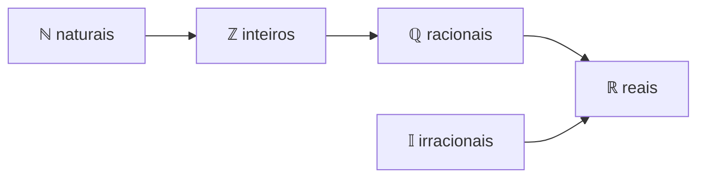

# Conjuntos Numéricos

> [!abstract] Em uma frase
> Cada conjunto numérico nasceu para resolver uma conta que o anterior não resolvia: $\mathbb{N} \subset \mathbb{Z} \subset \mathbb{Q} \subset \mathbb{R}$. Os **reais** são os racionais (frações) **mais** os irracionais (como $\sqrt{2}$ e $\pi$) e preenchem a reta inteira.

**Tema:** [[Aritmética]] · **Pré-requisitos:** todos os conceitos anteriores · **Próximo:** [[Treino Misto de Aritmética]] → [[Álgebra]]
**Praticar:** [[Conjuntos Numéricos - Exercícios]] · [[Conjuntos Numéricos - Gabarito]]
**Aprofundar:** [[Conjuntos Numéricos - Guia Completo]]

## ✅ Etapas
- [ ] Ler a explicação com o caderno aberto e resumir com as minhas palavras
- [ ] Refazer os exemplos resolvidos no caderno, sem olhar
- [ ] Fazer os exercícios 🟢 fáceis e 🟡 médios e corrigir pelo gabarito
- [ ] Anotar os erros no [[Caderno de Erros]]
- [ ] Tentar os 🔴 difíceis
- [ ] Responder à revisão ativa sem consultar
- [ ] Marcar `concluido`, preencher `concluido_em` e `proxima_revisao` (+7 dias)

## 🎯 Ao final, você deve conseguir
- Usar a notação de conjuntos ($\in, \subset, \cup, \cap$) e diagramas de Venn.
- Classificar qualquer número em $\mathbb{N}, \mathbb{Z}, \mathbb{Q}, \mathbb{I}$ e $\mathbb{R}$.
- Explicar o que é um número **irracional** e por que $\sqrt{2}$ é um deles.
- Juntar tudo da aritmética: frações, dízimas, raízes e negativos no mesmo exercício.

---

## 1. Noções de conjunto

Um **conjunto** é uma coleção de elementos: $A = \{1, 2, 3, 4, 6, 12\}$ (os divisores de 12).

| Símbolo | Significado | Exemplo |
|---|---|---|
| $\in$, $\notin$ | pertence, não pertence (elemento → conjunto) | $3 \in A$, $\;5 \notin A$ |
| $\subset$ | está contido (conjunto → conjunto) | $\{1, 2\} \subset A$ |
| $A \cup B$ | **união**: o que está em A **ou** em B | |
| $A \cap B$ | **interseção**: o que está em A **e** em B | |
| $A - B$ | **diferença**: o que está em A e **não** está em B | |
| $\emptyset$ | conjunto vazio | |

Com $A = \{1, 2, 3, 4, 6, 12\}$ e $B = \{1, 2, 3, 6, 9, 18\}$ (os divisores de 18):
$A \cap B = \{1, 2, 3, 6\}$ (os divisores **comuns**, e o maior é o [[MMC e MDC|MDC]]!), $\;A \cup B = \{1, 2, 3, 4, 6, 9, 12, 18\}$ e $A - B = \{4, 12\}$.

> [!tip] Contando com Venn
> $$n(A \cup B) = n(A) + n(B) - n(A \cap B)$$
> Quem está nos dois grupos foi contado duas vezes, então subtraímos uma vez. É a inclusão-exclusão de [[Múltiplos, Divisores e Primos]].

## 2. A escada dos conjuntos

| Conjunto | O que é | Resolve o problema de… | Exemplos |
|---|---|---|---|
| $\mathbb{N}$ **naturais** | $\{0, 1, 2, 3, \dots\}$ | contar | $0, 7, 2026$ |
| $\mathbb{Z}$ **inteiros** | naturais e seus opostos | $3 - 5$ | $-3, 0, 12$ |
| $\mathbb{Q}$ **racionais** | tudo que se escreve como $\frac{a}{b}$, com $a, b \in \mathbb{Z}$ e $b \neq 0$ | $3 \div 4$ | $\frac{2}{5}, -0{,}25, 0{,}\overline{3}, 7$ |
| $\mathbb{I}$ **irracionais** | decimais **infinitos e não periódicos** | $\sqrt{2}$, a diagonal do quadrado | $\sqrt{2}, \pi, \sqrt{3}, e$ |
| $\mathbb{R}$ **reais** | $\mathbb{Q} \cup \mathbb{I}$, todos os pontos da reta | medir qualquer comprimento | todos acima |

$$\mathbb{N} \subset \mathbb{Z} \subset \mathbb{Q} \subset \mathbb{R} \qquad \mathbb{I} \subset \mathbb{R} \qquad \mathbb{Q} \cap \mathbb{I} = \emptyset$$



> [!important] Racional ou irracional? Olhe o decimal
> - Decimal **finito** ou **dízima periódica** → **racional** (tem [[Números Decimais#4. Dízima → fração (a fração geratriz)|fração geratriz]]).
> - Decimal **infinito sem período** → **irracional**: $\sqrt{2} = 1{,}41421356\dots$, $\pi = 3{,}14159265\dots$
>
> Raiz exata é racional: $\sqrt{9} = 3$, $\sqrt{\frac{4}{9}} = \frac{2}{3}$. A raiz quadrada de um natural que **não é quadrado perfeito** é irracional: $\sqrt{2}, \sqrt{3}, \sqrt{8}$.

> [!question]- Por que $\sqrt{2}$ é irracional? (a prova clássica, clique para abrir)
> Suponha que $\sqrt{2} = \frac{a}{b}$, com a fração **irredutível**. Elevando ao quadrado: $2 = \frac{a^2}{b^2}$, ou seja, $a^2 = 2b^2$.
> 1. Então $a^2$ é par, e por isso $a$ é par (o quadrado de um ímpar é ímpar). Escreva $a = 2k$.
> 2. Substituindo: $4k^2 = 2b^2$, ou seja, $b^2 = 2k^2$. Então $b$ também é par.
> 3. Mas, se $a$ e $b$ são pares, a fração **não** era irredutível. **Contradição!**
>
> Logo, $\sqrt{2}$ não pode ser escrito como fração. Esse estilo de prova, que supõe o contrário e chega a um absurdo, se chama **prova por contradição** e aparece muito em olimpíadas.

## 3. Quais contas "fecham" em cada conjunto

| Conjunto | Soma | Subtração | Multiplicação | Divisão (por $\neq 0$) | Raiz quadrada |
|---|---|---|---|---|---|
| $\mathbb{N}$ | ✅ | ❌ $3 - 5$ | ✅ | ❌ $3 \div 4$ | ❌ |
| $\mathbb{Z}$ | ✅ | ✅ | ✅ | ❌ | ❌ |
| $\mathbb{Q}$ | ✅ | ✅ | ✅ | ✅ | ❌ $\sqrt{2}$ |
| $\mathbb{R}$ | ✅ | ✅ | ✅ | ✅ | ❌ $\sqrt{-1}$ (só de não negativos) |

A próxima "escada" são os **complexos** $\mathbb{C}$, que dão sentido a $\sqrt{-1}$. Não são necessários para a nossa trilha (veja os extras do [[Mapa da Matemática]]).

> [!info] Fatos úteis
> - Racional + irracional = **irracional**: $1 + \sqrt{2}$.
> - Racional (não nulo) × irracional = **irracional**: $3\sqrt{2}$.
> - Irracional + irracional **pode** ser racional: $\sqrt{2} + (-\sqrt{2}) = 0$. E $\sqrt{2} \cdot \sqrt{8} = 4$.
> - **Densidade:** entre dois números reais quaisquer há infinitos racionais **e** infinitos irracionais.

## 4. A reta real

Cada ponto da reta é **exatamente um** número real, e cada número real é um ponto. Os racionais sozinhos deixariam "buracos" (como o ponto $\sqrt{2}$); os irracionais tapam esses buracos.

```
   -2      -1       0       1    √2  1,5    2       3   π
 ───┼───────┼───────┼───────┼────┼───┼─────┼───────┼───┼──→
```

Os pedaços da reta (os **intervalos**, como $[1, 3)$) aparecem em [[Inequações do 1º Grau]].

---

## 📝 Exemplos resolvidos

> [!example] Exemplo 1: classificar
> | Número | $\mathbb{N}$ | $\mathbb{Z}$ | $\mathbb{Q}$ | $\mathbb{I}$ | $\mathbb{R}$ |
> |---|---|---|---|---|---|
> | $-\sqrt{9} = -3$ | | ✅ | ✅ | | ✅ |
> | $0{,}\overline{3}$ | | | ✅ | | ✅ |
> | $\sqrt{8} = 2\sqrt{2}$ | | | | ✅ | ✅ |
> | $\frac{\pi}{\pi} = 1$ | ✅ | ✅ | ✅ | | ✅ |

> [!example] Exemplo 2: tudo junto
> $$\left(0{,}\overline{2} + \tfrac{1}{3}\right) \cdot \sqrt{0{,}81} \div 3^{-1} = \left(\tfrac{2}{9} + \tfrac{3}{9}\right) \cdot \tfrac{9}{10} \cdot 3 = \tfrac{5}{9} \cdot \tfrac{9}{10} \cdot 3 = \tfrac{3}{2} \in \mathbb{Q}$$

> [!example] Exemplo 3: Venn
> De 40 pessoas, 25 usam Python, 18 usam C# e 8 usam as duas linguagens. Usam pelo menos uma: $25 + 18 - 8 = 35$. Não usam nenhuma: $40 - 35 = 5$.

---

## ⚠️ Erros comuns

| ❌ Errado | ✅ Certo | Por quê |
|---|---|---|
| "$0{,}333\dots$ é irracional" | racional ($\frac{1}{3}$) | é periódica |
| "$\pi = 3{,}14$" | $\pi \approx 3{,}14$ | $\pi$ é irracional; 3,14 é só uma aproximação |
| "Toda raiz é irracional" | $\sqrt{9} = 3$ | só as não exatas |
| "$-5$ não é racional" | $-5 = \frac{-5}{1}$ | todo inteiro é racional |
| $3 \subset \mathbb{N}$ | $3 \in \mathbb{N}$ | $\in$ é para elementos; $\subset$ é para conjuntos |
| "Irracional + irracional é irracional" | nem sempre | $\sqrt{2} + (-\sqrt{2}) = 0$ |

---

## 💻 Conexão com programação e ML

- **Tipos são conjuntos:** `byte` $\subset$ `int` $\subset$ `long` (todos "pedaços" de $\mathbb{Z}$). `double` **aproxima** $\mathbb{R}$, mas todo `double` é, na verdade, um racional com denominador potência de 2. Nenhum computador guarda $\sqrt{2}$ exatamente: `Math.Sqrt(2) * Math.Sqrt(2) == 2` dá `false`.
- `System.Numerics` tem `BigInteger` (inteiros sem limite) e `Complex` (os números complexos).
- **Operações de conjunto** em C#: `HashSet<T>` tem `UnionWith`, `IntersectWith` e `ExceptWith`; no LINQ, `Union`, `Intersect` e `Except`.
- **Em ML:**
  - Um dado com 768 atributos numéricos é um ponto de $\mathbb{R}^{768}$ (um vetor; veja [[Vetores e Operações Vetoriais]]). A notação $x \in \mathbb{R}^n$ aparece em todo artigo.
  - Atributos **categóricos** (cor, cidade) não são números: precisam ser convertidos (por exemplo, com *one-hot encoding*) antes de entrar no modelo.
  - Eventos em probabilidade são conjuntos: $P(A \cup B) = P(A) + P(B) - P(A \cap B)$ ([[Probabilidade Básica]]).

---

## 🔗 Conexões
- **Usa:** [[Números Inteiros]] ($\mathbb{Z}$), [[Frações e Equivalência]] e [[Números Decimais]] ($\mathbb{Q}$), [[Radiciação]] (os irracionais), [[Múltiplos, Divisores e Primos]] (paridade, na prova de que $\sqrt{2}$ é irracional).
- **Na álgebra:** [[Inequações do 1º Grau]] (intervalos da reta real) e o conjunto-solução de equações ([[Equações do 1º Grau]], [[Equações do 2º Grau]]).
- **Mais adiante:** [[Conceito de Função]] (domínio e imagem são conjuntos), [[Probabilidade Básica]] (eventos), [[Vetores e Operações Vetoriais]] ($\mathbb{R}^n$).
- **Treino:** feche o tema com o [[Treino Misto de Aritmética]].

---

## 🧠 Revisão ativa
*Responda sem olhar. Travou? Releia a seção correspondente.*

1. Qual é a diferença entre $\in$ e $\subset$? Dê um exemplo de cada.
2. Como saber, pela representação decimal, se um número é racional?
3. Classifique: $-\frac{12}{4}$, $\sqrt{0{,}25}$, $\sqrt{12}$, $0{,}1\overline{6}$, $\pi^0$.
4. Explique, em linhas gerais, a prova de que $\sqrt{2}$ é irracional.
5. Dê um exemplo de dois irracionais cujo produto seja racional.
6. Escreva a fórmula de $n(A \cup B)$ e explique o termo que se subtrai.
