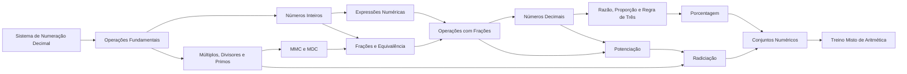

# 01 · Aritmética

> [!abstract] O que é
> A aritmética é a matemática dos **números e das operações**: inteiros, frações, decimais, potências e raízes. Tudo o que vem depois (álgebra, funções, cálculo, ML) é aritmética com letras no meio.

**Fase:** 1 · Fundamentos · **Mapa:** [[Mapa da Matemática]] · **Próximo tema:** [[Álgebra]]

> [!tip] Como estudar este tema
> Aqui o foco é **relembrar e ganhar fluência**. Então:
> 1. Faça o [[Aritmética - Diagnóstico|diagnóstico]] primeiro.
> 2. Nos conceitos em que acertou tudo, leia rápido, faça só os 🟡 e 🔴 e marque como concluído.
> 3. Nos conceitos em que errou, faça o ciclo completo (veja [[Comece Aqui]]).
> 4. Feche o tema com o [[Treino Misto de Aritmética]]: são 5 listas que misturam frações, dízimas, raízes, potências e negativos. **É a parte mais importante.**

## Trilha

| # | Conceito | Em uma linha |
|---|---|---|
| 01 | [[Sistema de Numeração Decimal]] | o valor de um algarismo depende da posição; base 10 e binário |
| 02 | [[Operações Fundamentais]] | propriedades, divisão com resto, por que não se divide por zero |
| 03 | [[Números Inteiros]] | negativos, módulo e regra de sinais |
| 04 | [[Expressões Numéricas]] | a ordem das operações |
| 05 | [[Múltiplos, Divisores e Primos]] | critérios de divisibilidade, primos e fatoração |
| 06 | [[MMC e MDC]] | ciclos que coincidem e o maior pedaço comum |
| 07 | [[Frações e Equivalência]] | o que é uma fração, simplificar e comparar |
| 08 | [[Operações com Frações]] | somar, multiplicar e dividir frações |
| 09 | [[Números Decimais]] | decimais, dízimas e fração geratriz |
| 10 | [[Razão, Proporção e Regra de Três]] | grandezas proporcionais |
| 11 | [[Porcentagem]] | fator multiplicativo, variações e juros |
| 12 | [[Potenciação]] | propriedades, expoente negativo e notação científica |
| 13 | [[Radiciação]] | raízes, simplificação e expoente fracionário |
| 14 | [[Conjuntos Numéricos]] | $\mathbb{N} \subset \mathbb{Z} \subset \mathbb{Q} \subset \mathbb{R}$ e os irracionais |
| 15 | [[Treino Misto de Aritmética]] | 5 listas misturando tudo |

## Progresso
![[Progresso.base#Aritmética]]

## Ao terminar
- [ ] Todos os conceitos marcados como concluídos
- [ ] As 5 listas do [[Treino Misto de Aritmética]] com pelo menos 80%
- [ ] [[Aritmética - Diagnóstico]] refeito, sem erros
- [ ] Uma prova de 1ª fase da OBMEP Nível 1 (veja [[Provas e Olimpíadas]])

➡️ Próximo tema: [[Álgebra]]
