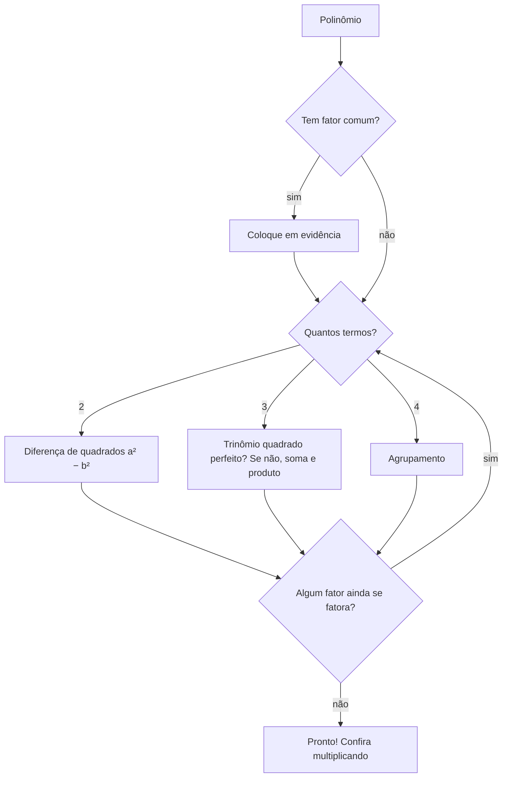

# Fatoração

> [!abstract] Em uma frase
> Fatorar é **transformar uma soma em multiplicação**, o caminho inverso de "desenvolver". É como escrever $360 = 2^3 \cdot 3^2 \cdot 5$, só que com polinômios: $x^2 + 5x + 6 = (x + 2)(x + 3)$.

**Tema:** [[Álgebra]] · **Pré-requisitos:** [[Produtos Notáveis]], [[Monômios e Polinômios]], [[MMC e MDC]] · **Próximo:** [[Frações Algébricas]]
**Praticar:** [[Fatoração - Exercícios]] · [[Fatoração - Gabarito]]

## ✅ Etapas
- [ ] Ler a explicação com o caderno aberto e resumir com as minhas palavras
- [ ] Refazer os exemplos resolvidos no caderno, sem olhar
- [ ] Fazer os exercícios 🟢 fáceis e 🟡 médios e corrigir pelo gabarito
- [ ] Anotar os erros no [[Caderno de Erros]]
- [ ] Tentar os 🔴 difíceis
- [ ] Responder à revisão ativa sem consultar
- [ ] Marcar `concluido`, preencher `concluido_em` e `proxima_revisao` (+7 dias)

## 🎯 Ao final, você deve conseguir
- Colocar o **fator comum em evidência**.
- Fatorar por **agrupamento**, **diferença de quadrados** e **trinômio quadrado perfeito**.
- Fatorar trinômios $x^2 + Sx + P$ por **soma e produto**.
- Seguir uma **estratégia** para escolher o método e fatorar até o fim.

---

## 1. Por que fatorar?

Produtos são mais fáceis de usar do que somas:
- **Simplificar frações:** $\frac{x^2 - 9}{x + 3} = \frac{(x + 3)(x - 3)}{x + 3} = x - 3$ (veja [[Frações Algébricas]]).
- **Resolver equações:** se $x(x - 5) = 0$, então $x = 0$ ou $x = 5$, porque um produto só é zero se um dos fatores for zero ([[Equações do 2º Grau]]).
- **Contas de cabeça:** $37 \cdot 43 = (40 - 3)(40 + 3) = 1600 - 9 = 1591$.

## 2. Caso 1: fator comum em evidência (sempre o primeiro a testar)

Procure o que **todos os termos** têm em comum: o [[MMC e MDC|MDC]] dos coeficientes e cada letra comum com o **menor expoente**.

$$6x^2 + 9x = 3x \cdot 2x + 3x \cdot 3 = 3x(2x + 3)$$

$$10a^3b - 15a^2b^2 = 5a^2b(2a - 3b)$$

> [!tip] Como conferir
> Aplique a distributiva no resultado: tem que voltar ao original. $3x(2x + 3) = 6x^2 + 9x$ ✔️. E o que fica dentro dos parênteses é cada termo **dividido** pelo fator comum.

> [!warning] Não esqueça o 1
> $x^2 + x = x(x + 1)$, e não $x(x)$. Quando um termo "sai inteiro", fica um **1** no lugar dele.

## 3. Caso 2: agrupamento (4 termos)

Agrupe dois a dois, coloque em evidência em cada grupo e procure um parêntese repetido:
$$ax + ay + 3x + 3y = a(x + y) + 3(x + y) = (x + y)(a + 3)$$
$$x^3 + 2x^2 + 3x + 6 = x^2(x + 2) + 3(x + 2) = (x + 2)(x^2 + 3)$$

## 4. Caso 3: diferença de quadrados (2 termos)

$$a^2 - b^2 = (a + b)(a - b)$$

É o [[Produtos Notáveis|produto notável]] lido ao contrário.

$$x^2 - 49 = (x + 7)(x - 7) \qquad 4x^2 - 25 = (2x + 5)(2x - 5)$$

> [!warning] Soma de quadrados não se fatora (nos reais)
> $x^2 + 9$ **não** é $(x + 3)^2$ nem $(x + 3)(x - 3)$. Ele fica como está.

## 5. Caso 4: trinômio quadrado perfeito (3 termos)

$$a^2 + 2ab + b^2 = (a + b)^2 \qquad a^2 - 2ab + b^2 = (a - b)^2$$

**Como reconhecer:** os dois extremos são quadrados ($a^2$ e $b^2$) **e** o termo do meio é $\pm 2 \cdot a \cdot b$.

> [!example] Testando $9y^2 - 12y + 4$
> - $9y^2 = (3y)^2$ ✔️ e $4 = 2^2$ ✔️
> - $2 \cdot 3y \cdot 2 = 12y$ ✔️ (com sinal de menos)
>
> Então $9y^2 - 12y + 4 = (3y - 2)^2$.

## 6. Caso 5: trinômio $x^2 + Sx + P$ (soma e produto)

Se $(x + m)(x + n) = x^2 + (m + n)x + mn$, então para fatorar $x^2 + Sx + P$ procure **dois números** com **soma $S$** e **produto $P$**.

> [!example] $x^2 + 7x + 12$
> Dois números com produto 12 e soma 7: os pares com produto 12 são (1, 12), (2, 6) e (3, 4). O que soma 7 é **(3, 4)**.
> $$x^2 + 7x + 12 = (x + 3)(x + 4)$$

> [!example] $x^2 - x - 12$ (com sinais)
> Produto $-12$ (os sinais são diferentes) e soma $-1$ (o maior em módulo é negativo): $-4$ e $3$.
> $$x^2 - x - 12 = (x - 4)(x + 3)$$

> [!tip] Dica de sinais
> - Produto **positivo** → os dois números têm o **mesmo** sinal (o sinal da soma).
> - Produto **negativo** → sinais **diferentes**, e o maior em módulo leva o sinal da soma.
>
> Comece **pelo produto**, que tem menos opções.

> [!question]- Tente agora (clique para ver as respostas)
> (a) $x^2 + 6x + 8$ (b) $x^2 - 2x - 15$ (c) $x^2 - 9x + 20$
> **Respostas:** (a) $(x + 2)(x + 4)$ (b) $(x - 5)(x + 3)$ (c) $(x - 4)(x - 5)$

Quando o coeficiente de $x^2$ não é 1 (como em $2x^2 + 7x + 3$), o jeito mais seguro é usar as raízes da equação, em [[Equações do 2º Grau]].

## 7. A estratégia completa

> [!example] Fatorando até o fim
> $2x^3 - 8x = 2x(x^2 - 4) = 2x(x + 2)(x - 2)$
> $x^4 - 1 = (x^2 + 1)(x^2 - 1) = (x^2 + 1)(x + 1)(x - 1)$

---

## 📝 Exemplos resolvidos

> [!example] Exemplo 1: evidência com fração
> $\frac{x^2}{2} - \frac{x}{4} = \frac{x}{4}(2x - 1)$ (o "MDC" de $\frac{1}{2}$ e $\frac{1}{4}$ é $\frac{1}{4}$; confira multiplicando).

> [!example] Exemplo 2: diferença de quadrados com frações e decimais
> $\frac{x^2}{4} - \frac{1}{9} = \left(\frac{x}{2} + \frac{1}{3}\right)\left(\frac{x}{2} - \frac{1}{3}\right)$
> $0{,}01a^2 - 0{,}49 = (0{,}1a + 0{,}7)(0{,}1a - 0{,}7)$

> [!example] Exemplo 3: evidência e depois quadrado perfeito
> $3x^2 - 6x + 3 = 3(x^2 - 2x + 1) = 3(x - 1)^2$

> [!example] Exemplo 4: conta grande
> $87^2 - 13^2 = (87 + 13)(87 - 13) = 100 \cdot 74 = 7400$

---

## ⚠️ Erros comuns

| ❌ Errado | ✅ Certo | Por quê |
|---|---|---|
| $x^2 + x = x(x)$ | $x(x + 1)$ | faltou o 1 |
| $-2x - 4 = -2(x - 4)$ | $-2(x + 2)$ | ao colocar um **negativo** em evidência, todos os sinais trocam |
| $x^2 + 9 = (x + 3)^2$ | não fatora | $(x + 3)^2 = x^2 + 6x + 9$ |
| $x^4 - 1 = (x^2 + 1)(x^2 - 1)$ e parar | $\dots(x + 1)(x - 1)$ | fatore até o fim |
| $x^2 - x - 12 = (x + 4)(x - 3)$ | $(x - 4)(x + 3)$ | a soma tem que dar $-1$: confira |

---

## 💻 Conexão com programação e ML

- **Fatorar economiza contas:** $ab + ac$ tem 2 multiplicações; $a(b + c)$ tem 1. Compiladores e bibliotecas numéricas fazem esse tipo de reescrita para ganhar velocidade. O método de Horner ([[Monômios e Polinômios]]) é uma fatoração repetida.
- **Em ML, "fatorar" é uma grande ideia:** decompor uma matriz enorme no produto de matrizes menores (fatoração de matrizes, SVD, LoRA para *fine-tuning* de LLMs) reduz memória e revela estrutura, como $360 = 2^3 \cdot 3^2 \cdot 5$ revela os divisores.
- **No cálculo**, a fatoração resolve limites do tipo $\frac{0}{0}$: $\lim_{x \to 3} \frac{x^2 - 9}{x - 3} = \lim_{x \to 3} (x + 3) = 6$ ([[Propriedades e Cálculo de Limites]]).

---

## 🔗 Conexões
- **Usa:** [[Produtos Notáveis]] (lidos ao contrário), [[Monômios e Polinômios]], [[MMC e MDC]] (o fator comum), [[Operações Fundamentais]] (a distributiva ao contrário).
- **É parecido com:** [[Múltiplos, Divisores e Primos]] (fatoração em primos).
- **É usado em:** [[Frações Algébricas]] (simplificar), [[Equações do 2º Grau]] e [[Equações Redutíveis ao 2º Grau]] (resolver por produto nulo).
- **Mais adiante:** [[Propriedades e Cálculo de Limites]] (limites $\frac{0}{0}$) e [[Função Quadrática]] (a forma fatorada mostra as raízes).

---

## 🧠 Revisão ativa
*Responda sem olhar. Travou? Releia a seção correspondente.*

1. O que significa fatorar? Por que um produto é mais útil do que uma soma?
2. Qual é o primeiro caso a testar? Fatore $12x^3 - 18x^2$.
3. Como reconhecer um trinômio quadrado perfeito? $x^2 + 6x + 9$ é um? E $x^2 + 6x + 8$?
4. Fatore $x^2 - 3x - 10$ por soma e produto. Como você escolheu os sinais?
5. Por que $x^2 + 4$ não se fatora como $(x + 2)^2$?
6. Fatore completamente $x^4 - 16$.
