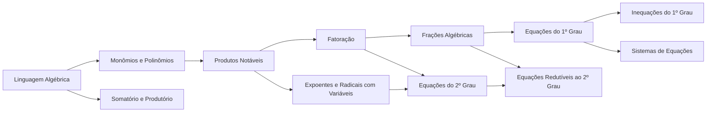

# 02 · Álgebra

> [!abstract] O que é
> A álgebra é a matemática com **letras no lugar de números**: ela permite escrever regras gerais, resolver problemas com valores desconhecidos e manipular fórmulas. É a linguagem de todo o resto: funções, cálculo e cada fórmula de machine learning.

**Fase:** 1 · Fundamentos · **Mapa:** [[Mapa da Matemática]] · **Tema anterior:** [[Aritmética]] · **Próximo tema:** [[Funções]]

> [!tip] Como estudar este tema
> Aqui o foco é **reaprender com calma**, um conceito de cada vez:
> 1. Faça o [[Álgebra - Diagnóstico|diagnóstico]] sem medo de errar. Ele só mostra por onde começar.
> 2. Siga a ordem da trilha. Cada conceito usa o anterior, então **não pule**.
> 3. Faça o ciclo completo (veja [[Comece Aqui]]) e use os blocos "**Tente agora**" dentro das explicações antes de ir para os exercícios.
> 4. Não avance sem acertar pelo menos 80% dos 🟢 e 🟡. Em álgebra, um buraco num conceito vira um muro no seguinte.
> 5. As listas 🔀 de cada conceito misturam frações, decimais, dízimas e raízes, continuando o [[Treino Misto de Aritmética]].

## Trilha

| # | Conceito | Em uma linha |
|---|---|---|
| 01 | [[Linguagem Algébrica]] | letras, tradução português ↔ álgebra e valor numérico |
| 02 | [[Monômios e Polinômios]] | termos semelhantes e as quatro operações com polinômios |
| 03 | [[Produtos Notáveis]] | $(a + b)^2$, $(a - b)^2$ e $(a + b)(a - b)$ |
| 04 | [[Fatoração]] | transformar somas em produtos |
| 05 | [[Frações Algébricas]] | simplificar e operar frações com letras |
| 06 | [[Equações do 1º Grau]] | a balança, isolar variáveis, equações com frações e raízes |
| 07 | [[Inequações do 1º Grau]] | desigualdades e intervalos |
| 08 | [[Sistemas de Equações]] | duas equações, duas incógnitas |
| 09 | [[Expoentes e Radicais com Variáveis]] | potências fracionárias e conjugado |
| 10 | [[Equações do 2º Grau]] | completar o quadrado, Bhaskara e soma e produto |
| 11 | [[Equações Redutíveis ao 2º Grau]] | biquadradas, fracionárias e irracionais |
| 12 | [[Somatório e Produtório]] | a notação $\Sigma$ e $\Pi$, porta de entrada das fórmulas de ML |

## Progresso
![[Progresso.base#Álgebra]]

## Ao terminar
- [ ] Todos os conceitos marcados como concluídos
- [ ] [[Álgebra - Diagnóstico]] refeito, com pelo menos 20 acertos
- [ ] Uma prova de 1ª fase da OBMEP Nível 2 (veja [[Provas e Olimpíadas]])

➡️ Próximo tema: [[Funções]]. Ele ainda está em esboço; veja [[Como Gerar Conteúdo]].
