# 03 · Funções

> [!abstract] O que é
> Uma função é uma regra que associa cada entrada a **exatamente uma** saída, como um método que recebe um valor e devolve outro. É o conceito central de toda a matemática daqui em diante.

**Fase:** 2 · Pré-cálculo · **Mapa:** [[Mapa da Matemática]] · **Tema anterior:** [[Álgebra]] · **Próximo tema:** [[Exponenciais e Logaritmos]]

> [!todo] Tema em esboço
> Cada conceito abaixo já tem a sua pasta, com uma nota curta dizendo **o que estudar**. Quando chegar a vez deste tema, gere o conteúdo completo (explicações, exercícios 🟢🟡🔴, gabaritos e o diagnóstico do tema) com o prompt de [[Como Gerar Conteúdo]].

## Por que importa (e onde aparece em ML)
Um modelo de ML **é** uma função: recebe dados e devolve uma previsão. Treinar é escolher a função certa. Gráficos, composição (camadas de uma rede neural) e funções inversas aparecem o tempo todo.

## Antes de começar, domine
- [[Equações do 1º Grau]]
- [[Equações do 2º Grau]]
- [[Inequações do 1º Grau]]
- [[Conjuntos Numéricos]]

## Trilha

```mermaid
flowchart LR
    C0["Plano Cartesiano"]
    C1["Conceito de Função"]
    C2["Gráficos de Funções"]
    C3["Função Afim"]
    C4["Função Quadrática"]
    C5["Função Modular"]
    C6["Transformações de Gráficos"]
    C7["Composição de Funções"]
    C8["Função Inversa"]
    C0 --> C1
    C1 --> C2
    C2 --> C3
    C3 --> C4
    C4 --> C5
    C5 --> C6
    C6 --> C7
    C7 --> C8
    class C0,C1,C2,C3,C4,C5,C6,C7,C8 internal-link;
```

| # | Conceito | O que é |
|---|---|---|
| 01 | [[Plano Cartesiano]] | O sistema de coordenadas $(x, y)$ que transforma pontos em pares de números e equações em desenhos. |
| 02 | [[Conceito de Função]] | Uma regra $f$ que leva cada elemento do **domínio** a um único elemento do **contradomínio**; os valores atingidos formam a **imagem**. |
| 03 | [[Gráficos de Funções]] | Ler e interpretar o gráfico de uma função: onde ela cresce, decresce, cruza os eixos e é positiva ou negativa. |
| 04 | [[Função Afim]] | Funções da forma $f(x) = ax + b$, cujo gráfico é uma **reta**: $a$ é a inclinação e $b$ é onde a reta corta o eixo $y$. |
| 05 | [[Função Quadrática]] | Funções $f(x) = ax^2 + bx + c$, cujo gráfico é uma **parábola**, com concavidade para cima ou para baixo e um **vértice**. |
| 06 | [[Função Modular]] | A função $f(x) = \lvert x \rvert$ e suas variações: o módulo como **distância** até o zero. |
| 07 | [[Transformações de Gráficos]] | Como o gráfico de $f(x)$ muda quando fazemos $f(x) + k$, $f(x + k)$, $a \cdot f(x)$ ou $f(-x)$. |
| 08 | [[Composição de Funções]] | Aplicar uma função no resultado de outra: $(g \circ f)(x) = g(f(x))$. |
| 09 | [[Função Inversa]] | A função $f^{-1}$ que **desfaz** $f$: se $f(a) = b$, então $f^{-1}(b) = a$. |

## Progresso
![[Progresso.base#Funções]]

## Ao terminar
- [ ] Todos os conceitos marcados como concluídos
- [ ] Diagnóstico do tema refeito (ele é criado junto com o conteúdo)
- [ ] Provas para se testar: **Nível 3** (veja [[Provas e Olimpíadas]])

➡️ Próximo tema: [[Exponenciais e Logaritmos]]
