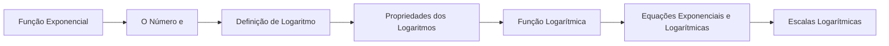

# 04 · Exponenciais e Logaritmos

> [!abstract] O que é
> O crescimento **exponencial** (juros compostos, populações, vírus) e o **logaritmo**, que é a pergunta inversa: "a que expoente devo elevar a base para obter este número?".

**Fase:** 2 · Pré-cálculo · **Mapa:** [[Mapa da Matemática]] · **Tema anterior:** [[Funções]] · **Próximo tema:** [[Geometria Plana]]

> [!todo] Tema em esboço
> Cada conceito abaixo já tem a sua pasta, com uma nota curta dizendo **o que estudar**. Quando chegar a vez deste tema, gere o conteúdo completo (explicações, exercícios 🟢🟡🔴, gabaritos e o diagnóstico do tema) com o prompt de [[Como Gerar Conteúdo]].

## Por que importa (e onde aparece em ML)
Está em toda parte em ML: a *softmax* e a sigmoide usam $e^x$; a função de perda mais usada em classificação é a *log-loss* (cross-entropy); maximizamos a **log**-verossimilhança; e gráficos de treino costumam usar escala logarítmica.

## Antes de começar, domine
- [[Potenciação]]
- [[Expoentes e Radicais com Variáveis]]
- [[Função Inversa]]
- [[Porcentagem]]

## Trilha

| # | Conceito | O que é |
|---|---|---|
| 01 | [[Função Exponencial]] | Funções $f(x) = a^x$ (com $a > 0$ e $a \neq 1$), que multiplicam o valor por um fator fixo a cada passo. |
| 02 | [[O Número e]] | A constante $e \approx 2{,}718$, que aparece naturalmente quando o crescimento é **contínuo**. |
| 03 | [[Definição de Logaritmo]] | $\log_a b = c \iff a^c = b$: o logaritmo é **o expoente**. |
| 04 | [[Propriedades dos Logaritmos]] | As regras que transformam produtos em somas, quocientes em diferenças e potências em multiplicações. |
| 05 | [[Função Logarítmica]] | A função $f(x) = \log_a x$, inversa da exponencial. |
| 06 | [[Equações Exponenciais e Logarítmicas]] | Equações com a incógnita no expoente ou dentro de um logaritmo. |
| 07 | [[Escalas Logarítmicas]] | Gráficos e medidas em que cada marca vale **10 vezes** a anterior (escala Richter, decibéis, pH). |

## Progresso
![[Progresso.base#Exponenciais e Logaritmos]]

## Ao terminar
- [ ] Todos os conceitos marcados como concluídos
- [ ] Diagnóstico do tema refeito (ele é criado junto com o conteúdo)
- [ ] Provas para se testar: **Nível 3** (veja [[Provas e Olimpíadas]])

➡️ Próximo tema: [[Geometria Plana]]
