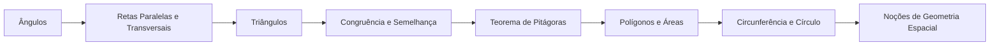

# 05 · Geometria Plana

> [!abstract] O que é
> As figuras do plano: ângulos, triângulos, polígonos e círculos, com as suas medidas de comprimento e área.

**Fase:** 2 · Pré-cálculo · **Mapa:** [[Mapa da Matemática]] · **Tema anterior:** [[Exponenciais e Logaritmos]] · **Próximo tema:** [[Trigonometria]]

> [!todo] Tema em esboço
> Cada conceito abaixo já tem a sua pasta, com uma nota curta dizendo **o que estudar**. Quando chegar a vez deste tema, gere o conteúdo completo (explicações, exercícios 🟢🟡🔴, gabaritos e o diagnóstico do tema) com o prompt de [[Como Gerar Conteúdo]].

## Por que importa (e onde aparece em ML)
É a base da trigonometria e da geometria analítica. A intuição geométrica (distâncias, ângulos, semelhança) é o que dá sentido a vetores, normas e similaridade de cosseno em ML.

## Antes de começar, domine
- [[Razão, Proporção e Regra de Três]]
- [[Equações do 1º Grau]]
- [[Radiciação]]

## Trilha

| # | Conceito | O que é |
|---|---|---|
| 01 | [[Ângulos]] | A abertura entre duas semirretas, medida em graus. |
| 02 | [[Retas Paralelas e Transversais]] | Os ângulos que se formam quando uma reta corta duas paralelas. |
| 03 | [[Triângulos]] | O polígono mais simples e mais importante. |
| 04 | [[Congruência e Semelhança]] | Quando dois triângulos são iguais (congruentes) ou têm a mesma forma em tamanhos diferentes (semelhantes). |
| 05 | [[Teorema de Pitágoras]] | Num triângulo retângulo, $a^2 = b^2 + c^2$. |
| 06 | [[Polígonos e Áreas]] | Polígonos e as fórmulas de área das figuras planas. |
| 07 | [[Circunferência e Círculo]] | A curva de pontos à mesma distância do centro e a região que ela delimita. |
| 08 | [[Noções de Geometria Espacial]] | Sólidos básicos e seus volumes. |

## Progresso
![[Progresso.base#Geometria Plana]]

## Ao terminar
- [ ] Todos os conceitos marcados como concluídos
- [ ] Diagnóstico do tema refeito (ele é criado junto com o conteúdo)
- [ ] Provas para se testar: **Nível 2 e 3** (veja [[Provas e Olimpíadas]])

➡️ Próximo tema: [[Trigonometria]]
