# 06 · Trigonometria

> [!abstract] O que é
> O estudo das relações entre ângulos e lados, que depois vira o estudo das funções **periódicas** (seno, cosseno, tangente).

**Fase:** 2 · Pré-cálculo · **Mapa:** [[Mapa da Matemática]] · **Tema anterior:** [[Geometria Plana]] · **Próximo tema:** [[Geometria Analítica]]

> [!todo] Tema em esboço
> Cada conceito abaixo já tem a sua pasta, com uma nota curta dizendo **o que estudar**. Quando chegar a vez deste tema, gere o conteúdo completo (explicações, exercícios 🟢🟡🔴, gabaritos e o diagnóstico do tema) com o prompt de [[Como Gerar Conteúdo]].

## Por que importa (e onde aparece em ML)
O cosseno mede a similaridade entre vetores (embeddings); senos e cossenos codificam posições nos Transformers (*positional encoding*); e as funções periódicas são a base da análise de sinais e séries temporais.

## Antes de começar, domine
- [[Congruência e Semelhança]]
- [[Teorema de Pitágoras]]
- [[Circunferência e Círculo]]
- [[Conceito de Função]]

## Trilha

```mermaid
flowchart LR
    C0["Trigonometria no Triângulo Retângulo"]
    C1["Ângulos Notáveis"]
    C2["Radianos"]
    C3["Ciclo Trigonométrico"]
    C4["Funções Seno e Cosseno"]
    C5["Função Tangente"]
    C6["Identidades Trigonométricas"]
    C7["Adição de Arcos"]
    C8["Lei dos Senos e Lei dos Cossenos"]
    C9["Equações Trigonométricas"]
    C0 --> C1
    C1 --> C2
    C2 --> C3
    C3 --> C4
    C4 --> C5
    C5 --> C6
    C6 --> C7
    C7 --> C8
    C8 --> C9
    class C0,C1,C2,C3,C4,C5,C6,C7,C8,C9 internal-link;
```

| # | Conceito | O que é |
|---|---|---|
| 01 | [[Trigonometria no Triângulo Retângulo]] | Seno, cosseno e tangente como **razões** entre os lados de um triângulo retângulo. |
| 02 | [[Ângulos Notáveis]] | Os valores exatos de seno, cosseno e tangente de $30°$, $45°$ e $60°$. |
| 03 | [[Radianos]] | Medir ângulos pelo **comprimento do arco** em vez de graus. |
| 04 | [[Ciclo Trigonométrico]] | A circunferência de raio 1 que estende seno e cosseno para **qualquer** ângulo. |
| 05 | [[Funções Seno e Cosseno]] | As funções $\operatorname{sen} x$ e $\cos x$, seus gráficos e suas propriedades. |
| 06 | [[Função Tangente]] | A função $\operatorname{tg} x = \frac{\operatorname{sen} x}{\cos x}$. |
| 07 | [[Identidades Trigonométricas]] | Igualdades que valem para todo ângulo e permitem simplificar expressões. |
| 08 | [[Adição de Arcos]] | Fórmulas para $\operatorname{sen}(a \pm b)$, $\cos(a \pm b)$ e arcos duplos. |
| 09 | [[Lei dos Senos e Lei dos Cossenos]] | Relações para resolver **qualquer** triângulo, não só os retângulos. |
| 10 | [[Equações Trigonométricas]] | Equações como $\operatorname{sen} x = \frac{1}{2}$, com infinitas soluções periódicas. |

## Progresso
![[Progresso.base#Trigonometria]]

## Ao terminar
- [ ] Todos os conceitos marcados como concluídos
- [ ] Diagnóstico do tema refeito (ele é criado junto com o conteúdo)
- [ ] Provas para se testar: **Nível 3** (veja [[Provas e Olimpíadas]])

➡️ Próximo tema: [[Geometria Analítica]]
