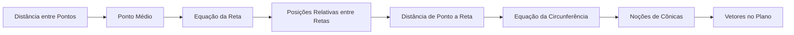

# 07 · Geometria Analítica

> [!abstract] O que é
> Geometria feita com **coordenadas e equações**: pontos viram pares de números, retas e circunferências viram equações.

**Fase:** 2 · Pré-cálculo · **Mapa:** [[Mapa da Matemática]] · **Tema anterior:** [[Trigonometria]] · **Próximo tema:** [[Sequências e Séries]]

> [!todo] Tema em esboço
> Cada conceito abaixo já tem a sua pasta, com uma nota curta dizendo **o que estudar**. Quando chegar a vez deste tema, gere o conteúdo completo (explicações, exercícios 🟢🟡🔴, gabaritos e o diagnóstico do tema) com o prompt de [[Como Gerar Conteúdo]].

## Por que importa (e onde aparece em ML)
Distância entre pontos é o coração do k-NN e do k-means; a equação da reta é a fronteira de decisão de classificadores lineares; e os vetores no plano são o primeiro passo da álgebra linear.

## Antes de começar, domine
- [[Plano Cartesiano]]
- [[Função Afim]]
- [[Teorema de Pitágoras]]
- [[Sistemas de Equações]]

## Trilha

| # | Conceito | O que é |
|---|---|---|
| 01 | [[Distância entre Pontos]] | A fórmula $d = \sqrt{(x_2 - x_1)^2 + (y_2 - y_1)^2}$, que é Pitágoras no plano. |
| 02 | [[Ponto Médio]] | O ponto exatamente no meio de um segmento, e o baricentro de um triângulo. |
| 03 | [[Equação da Reta]] | Formas de escrever uma reta: $y = mx + n$, $ax + by + c = 0$ e a partir de dois pontos. |
| 04 | [[Posições Relativas entre Retas]] | Retas paralelas, concorrentes, coincidentes e perpendiculares. |
| 05 | [[Distância de Ponto a Reta]] | A menor distância entre um ponto e uma reta. |
| 06 | [[Equação da Circunferência]] | $(x - a)^2 + (y - b)^2 = r^2$: todos os pontos a uma distância $r$ do centro. |
| 07 | [[Noções de Cônicas]] | Elipse, hipérbole e parábola como curvas no plano. |
| 08 | [[Vetores no Plano]] | Segmentos orientados com módulo, direção e sentido, escritos como pares $(x, y)$. |

## Progresso
![[Progresso.base#Geometria Analítica]]

## Ao terminar
- [ ] Todos os conceitos marcados como concluídos
- [ ] Diagnóstico do tema refeito (ele é criado junto com o conteúdo)
- [ ] Provas para se testar: **Nível 3** (veja [[Provas e Olimpíadas]])

➡️ Próximo tema: [[Sequências e Séries]]
