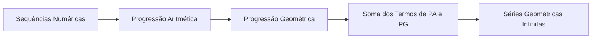

# 08 · Sequências e Séries

> [!abstract] O que é
> Listas ordenadas de números que seguem um padrão (como as progressões aritmética e geométrica) e a soma dos seus termos, inclusive quando são **infinitos**.

**Fase:** 2 · Pré-cálculo · **Mapa:** [[Mapa da Matemática]] · **Tema anterior:** [[Geometria Analítica]] · **Próximo tema:** [[Cálculo Diferencial]]

> [!todo] Tema em esboço
> Cada conceito abaixo já tem a sua pasta, com uma nota curta dizendo **o que estudar**. Quando chegar a vez deste tema, gere o conteúdo completo (explicações, exercícios 🟢🟡🔴, gabaritos e o diagnóstico do tema) com o prompt de [[Como Gerar Conteúdo]].

## Por que importa (e onde aparece em ML)
Séries geométricas aparecem no decaimento da taxa de aprendizado, nos fatores de desconto do aprendizado por reforço ($\sum \gamma^t r_t$) e nas médias móveis exponenciais dos otimizadores (Adam, *momentum*). E a ideia de "chegar cada vez mais perto" é o limite do cálculo.

## Antes de começar, domine
- [[Conceito de Função]]
- [[Somatório e Produtório]]
- [[Potenciação]]

## Trilha

| # | Conceito | O que é |
|---|---|---|
| 01 | [[Sequências Numéricas]] | Funções cujo domínio são os naturais: $a_1, a_2, a_3, \dots$ |
| 02 | [[Progressão Aritmética]] | Sequências em que se **soma** sempre a mesma razão $r$. |
| 03 | [[Progressão Geométrica]] | Sequências em que se **multiplica** sempre pela mesma razão $q$. |
| 04 | [[Soma dos Termos de PA e PG]] | Fórmulas para somar os $n$ primeiros termos de uma PA ou de uma PG. |
| 05 | [[Séries Geométricas Infinitas]] | A soma de **infinitos** termos de uma PG com $\lvert q \rvert < 1$, que dá um número finito: $\frac{a_1}{1 - q}$. |

## Progresso
![[Progresso.base#Sequências e Séries]]

## Ao terminar
- [ ] Todos os conceitos marcados como concluídos
- [ ] Diagnóstico do tema refeito (ele é criado junto com o conteúdo)
- [ ] Provas para se testar: **Nível 2 e 3** (veja [[Provas e Olimpíadas]])

➡️ Próximo tema: [[Cálculo Diferencial]]
