# 09 · Cálculo Diferencial

> [!abstract] O que é
> O estudo da **variação**: limites, continuidade e a **derivada**, que mede a taxa de variação instantânea (a inclinação de uma curva em cada ponto).

**Fase:** 3 · Cálculo · **Mapa:** [[Mapa da Matemática]] · **Tema anterior:** [[Sequências e Séries]] · **Próximo tema:** [[Cálculo Integral]]

> [!todo] Tema em esboço
> Cada conceito abaixo já tem a sua pasta, com uma nota curta dizendo **o que estudar**. Quando chegar a vez deste tema, gere o conteúdo completo (explicações, exercícios 🟢🟡🔴, gabaritos e o diagnóstico do tema) com o prompt de [[Como Gerar Conteúdo]].

## Por que importa (e onde aparece em ML)
É o motor do aprendizado: treinar um modelo é calcular a derivada (o gradiente) do erro em relação aos pesos e andar no sentido que o diminui. O *backpropagation* é a regra da cadeia aplicada em larga escala.

## Antes de começar, domine
- [[Funções]]
- [[Exponenciais e Logaritmos]]
- [[Trigonometria]]
- [[Sequências e Séries]]

## Trilha

```mermaid
flowchart LR
    C0["Noção de Limite"]
    C1["Propriedades e Cálculo de Limites"]
    C2["Limites Laterais e no Infinito"]
    C3["Continuidade"]
    C4["Definição de Derivada"]
    C5["Regras de Derivação"]
    C6["Regra da Cadeia"]
    C7["Derivadas de Funções Elementares"]
    C8["Análise de Gráficos com Derivadas"]
    C9["Otimização (Máximos e Mínimos)"]
    C10["Regra de L'Hôpital"]
    C0 --> C1
    C1 --> C2
    C2 --> C3
    C3 --> C4
    C4 --> C5
    C5 --> C6
    C6 --> C7
    C7 --> C8
    C8 --> C9
    C9 --> C10
    class C0,C1,C2,C3,C4,C5,C6,C7,C8,C9,C10 internal-link;
```

| # | Conceito | O que é |
|---|---|---|
| 01 | [[Noção de Limite]] | O valor de que $f(x)$ se aproxima quando $x$ se aproxima de um número, mesmo que nunca chegue nele. |
| 02 | [[Propriedades e Cálculo de Limites]] | Como calcular limites algebricamente, inclusive as indeterminações $\frac{0}{0}$. |
| 03 | [[Limites Laterais e no Infinito]] | Limites pela esquerda e pela direita, limites infinitos e assíntotas. |
| 04 | [[Continuidade]] | Uma função é contínua quando o seu gráfico não tem "saltos" nem "buracos". |
| 05 | [[Definição de Derivada]] | A derivada $f'(x)$ é o limite da taxa de variação: a inclinação da reta tangente. |
| 06 | [[Regras de Derivação]] | Atalhos para derivar sem usar a definição. |
| 07 | [[Regra da Cadeia]] | Como derivar uma **composição** de funções: $(g(f(x)))' = g'(f(x)) \cdot f'(x)$. |
| 08 | [[Derivadas de Funções Elementares]] | As derivadas de $e^x$, $\ln x$, $\operatorname{sen} x$, $\cos x$ e companhia. |
| 09 | [[Análise de Gráficos com Derivadas]] | Usar $f'$ e $f''$ para descobrir onde a função cresce, decresce, tem máximos, mínimos e muda de curvatura. |
| 10 | [[Otimização (Máximos e Mínimos)]] | Encontrar o maior ou o menor valor de uma função, resolvendo $f'(x) = 0$. |
| 11 | [[Regra de L'Hôpital]] | Uma ferramenta para calcular limites $\frac{0}{0}$ e $\frac{\infty}{\infty}$ usando derivadas. |

## Progresso
![[Progresso.base#Cálculo Diferencial]]

## Ao terminar
- [ ] Todos os conceitos marcados como concluídos
- [ ] Diagnóstico do tema refeito (ele é criado junto com o conteúdo)
- [ ] Provas para se testar: **(fora da OBMEP: use as listas de vestibulares e livros de cálculo)** (veja [[Provas e Olimpíadas]])

➡️ Próximo tema: [[Cálculo Integral]]
