# 10 · Cálculo Integral

> [!abstract] O que é
> A **integral**: o processo inverso da derivada e, ao mesmo tempo, a ferramenta para calcular áreas, acumulações e somas contínuas.

**Fase:** 3 · Cálculo · **Mapa:** [[Mapa da Matemática]] · **Tema anterior:** [[Cálculo Diferencial]] · **Próximo tema:** [[Matrizes e Sistemas Lineares]]

> [!todo] Tema em esboço
> Cada conceito abaixo já tem a sua pasta, com uma nota curta dizendo **o que estudar**. Quando chegar a vez deste tema, gere o conteúdo completo (explicações, exercícios 🟢🟡🔴, gabaritos e o diagnóstico do tema) com o prompt de [[Como Gerar Conteúdo]].

## Por que importa (e onde aparece em ML)
Probabilidades de variáveis contínuas são áreas sob curvas (integrais); a esperança de uma distribuição é uma integral; e métricas como a AUC são áreas.

## Antes de começar, domine
- [[Cálculo Diferencial]]
- [[Somatório e Produtório]]
- [[Polígonos e Áreas]]

## Trilha

```mermaid
flowchart LR
    C0["Antiderivadas"]
    C1["Integral Indefinida"]
    C2["Somas de Riemann"]
    C3["Integral Definida"]
    C4["Teorema Fundamental do Cálculo"]
    C5["Integração por Substituição"]
    C6["Integração por Partes"]
    C7["Área entre Curvas"]
    C8["Integrais Impróprias"]
    C0 --> C1
    C1 --> C2
    C2 --> C3
    C3 --> C4
    C4 --> C5
    C5 --> C6
    C6 --> C7
    C7 --> C8
    class C0,C1,C2,C3,C4,C5,C6,C7,C8 internal-link;
```

| # | Conceito | O que é |
|---|---|---|
| 01 | [[Antiderivadas]] | Encontrar uma função $F$ cuja derivada é $f$. |
| 02 | [[Integral Indefinida]] | A notação $\int f(x)\,dx$ e as regras básicas de integração. |
| 03 | [[Somas de Riemann]] | Aproximar a área sob uma curva somando a área de muitos retângulos. |
| 04 | [[Integral Definida]] | A área (com sinal) sob uma curva entre $a$ e $b$: $\int_a^b f(x)\,dx$. |
| 05 | [[Teorema Fundamental do Cálculo]] | O teorema que liga derivadas e integrais: $\int_a^b f(x)\,dx = F(b) - F(a)$. |
| 06 | [[Integração por Substituição]] | A "regra da cadeia ao contrário": uma mudança de variável que simplifica a integral. |
| 07 | [[Integração por Partes]] | A "regra do produto ao contrário": $\int u\,dv = uv - \int v\,du$. |
| 08 | [[Área entre Curvas]] | Calcular a área da região entre dois gráficos. |
| 09 | [[Integrais Impróprias]] | Integrais em intervalos infinitos ou de funções que "explodem". |

## Progresso
![[Progresso.base#Cálculo Integral]]

## Ao terminar
- [ ] Todos os conceitos marcados como concluídos
- [ ] Diagnóstico do tema refeito (ele é criado junto com o conteúdo)
- [ ] Provas para se testar: **(fora da OBMEP: use as listas de vestibulares e livros de cálculo)** (veja [[Provas e Olimpíadas]])

➡️ Próximo tema: [[Matrizes e Sistemas Lineares]]
