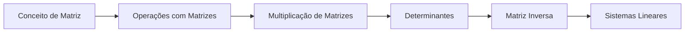

# 11 · Matrizes e Sistemas Lineares

> [!abstract] O que é
> Tabelas de números (matrizes), suas operações e o uso delas para resolver sistemas com muitas equações e muitas incógnitas.

**Fase:** 4 · Matrizes, probabilidade e estatística · **Mapa:** [[Mapa da Matemática]] · **Tema anterior:** [[Cálculo Integral]] · **Próximo tema:** [[Combinatória e Probabilidade]]

> [!todo] Tema em esboço
> Cada conceito abaixo já tem a sua pasta, com uma nota curta dizendo **o que estudar**. Quando chegar a vez deste tema, gere o conteúdo completo (explicações, exercícios 🟢🟡🔴, gabaritos e o diagnóstico do tema) com o prompt de [[Como Gerar Conteúdo]].

## Por que importa (e onde aparece em ML)
Matrizes **são** a linguagem de ML: um conjunto de dados é uma matriz (linhas = exemplos, colunas = atributos), os pesos de cada camada de uma rede neural são uma matriz, e quase todo cálculo é uma multiplicação de matrizes (é isso que as GPUs fazem).

## Antes de começar, domine
- [[Sistemas de Equações]]
- [[Somatório e Produtório]]

## Trilha

| # | Conceito | O que é |
|---|---|---|
| 01 | [[Conceito de Matriz]] | Uma tabela retangular de números, com $m$ linhas e $n$ colunas. |
| 02 | [[Operações com Matrizes]] | Soma, subtração e multiplicação de uma matriz por um número. |
| 03 | [[Multiplicação de Matrizes]] | A operação "linha × coluna", que **não** é feita elemento a elemento. |
| 04 | [[Determinantes]] | Um número associado a uma matriz quadrada que diz se ela é "invertível". |
| 05 | [[Matriz Inversa]] | A matriz $A^{-1}$ tal que $AA^{-1} = I$, que "desfaz" a multiplicação por $A$. |
| 06 | [[Sistemas Lineares]] | Sistemas com várias equações e incógnitas, resolvidos por **escalonamento**. |

## Progresso
![[Progresso.base#Matrizes e Sistemas Lineares]]

## Ao terminar
- [ ] Todos os conceitos marcados como concluídos
- [ ] Diagnóstico do tema refeito (ele é criado junto com o conteúdo)
- [ ] Provas para se testar: **Nível 3** (veja [[Provas e Olimpíadas]])

➡️ Próximo tema: [[Combinatória e Probabilidade]]
