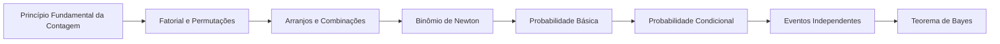

# 12 · Combinatória e Probabilidade

> [!abstract] O que é
> Técnicas para **contar** possibilidades sem listar todas, e a probabilidade, que mede a chance de cada resultado.

**Fase:** 4 · Matrizes, probabilidade e estatística · **Mapa:** [[Mapa da Matemática]] · **Tema anterior:** [[Matrizes e Sistemas Lineares]] · **Próximo tema:** [[Estatística Básica]]

> [!todo] Tema em esboço
> Cada conceito abaixo já tem a sua pasta, com uma nota curta dizendo **o que estudar**. Quando chegar a vez deste tema, gere o conteúdo completo (explicações, exercícios 🟢🟡🔴, gabaritos e o diagnóstico do tema) com o prompt de [[Como Gerar Conteúdo]].

## Por que importa (e onde aparece em ML)
Modelos de ML são, no fundo, modelos de probabilidade: a saída de um classificador é uma probabilidade, o teorema de Bayes está por trás do Naive Bayes e do raciocínio sob incerteza, e a contagem aparece ao estimar quantas combinações de hiperparâmetros testar.

## Antes de começar, domine
- [[Operações com Frações]]
- [[Porcentagem]]
- [[Conjuntos Numéricos]]
- [[Somatório e Produtório]]

## Trilha

| # | Conceito | O que é |
|---|---|---|
| 01 | [[Princípio Fundamental da Contagem]] | Se uma escolha tem $m$ opções e outra tem $n$, as duas juntas têm $m \cdot n$. |
| 02 | [[Fatorial e Permutações]] | O número de formas de ordenar $n$ objetos: $n! = n \cdot (n - 1) \cdots 1$. |
| 03 | [[Arranjos e Combinações]] | Escolher $k$ de $n$ objetos, quando a ordem importa (arranjo) ou não (combinação). |
| 04 | [[Binômio de Newton]] | A fórmula para desenvolver $(a + b)^n$, com coeficientes do triângulo de Pascal. |
| 05 | [[Probabilidade Básica]] | $P(A) = \frac{\text{casos favoráveis}}{\text{casos possíveis}}$, para resultados igualmente prováveis. |
| 06 | [[Probabilidade Condicional]] | A probabilidade de $A$ **sabendo que** $B$ aconteceu: $P(A \mid B) = \frac{P(A \cap B)}{P(B)}$. |
| 07 | [[Eventos Independentes]] | Quando saber de um evento não muda a probabilidade do outro: $P(A \cap B) = P(A) \cdot P(B)$. |
| 08 | [[Teorema de Bayes]] | Como **inverter** uma probabilidade condicional: obter $P(A \mid B)$ a partir de $P(B \mid A)$. |

## Progresso
![[Progresso.base#Combinatória e Probabilidade]]

## Ao terminar
- [ ] Todos os conceitos marcados como concluídos
- [ ] Diagnóstico do tema refeito (ele é criado junto com o conteúdo)
- [ ] Provas para se testar: **Nível 2 e 3** (veja [[Provas e Olimpíadas]])

➡️ Próximo tema: [[Estatística Básica]]
