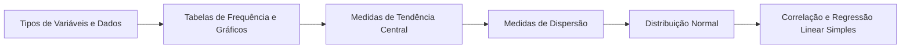

# 13 · Estatística Básica

> [!abstract] O que é
> Como **resumir e descrever dados**: tabelas, gráficos, médias, medidas de dispersão e relações entre variáveis.

**Fase:** 4 · Matrizes, probabilidade e estatística · **Mapa:** [[Mapa da Matemática]] · **Tema anterior:** [[Combinatória e Probabilidade]] · **Próximo tema:** [[Ponte para Machine Learning]]

> [!todo] Tema em esboço
> Cada conceito abaixo já tem a sua pasta, com uma nota curta dizendo **o que estudar**. Quando chegar a vez deste tema, gere o conteúdo completo (explicações, exercícios 🟢🟡🔴, gabaritos e o diagnóstico do tema) com o prompt de [[Como Gerar Conteúdo]].

## Por que importa (e onde aparece em ML)
Antes de treinar qualquer modelo, você explora os dados com estatística. Normalização, detecção de *outliers*, métricas de avaliação e a própria regressão linear vêm daqui.

## Antes de começar, domine
- [[Porcentagem]]
- [[Somatório e Produtório]]
- [[Radiciação]]

## Trilha

| # | Conceito | O que é |
|---|---|---|
| 01 | [[Tipos de Variáveis e Dados]] | Variáveis qualitativas (categorias) e quantitativas (números), discretas e contínuas. |
| 02 | [[Tabelas de Frequência e Gráficos]] | Organizar dados em tabelas de frequência e representá-los em gráficos. |
| 03 | [[Medidas de Tendência Central]] | Média, mediana e moda: um número que "representa" os dados. |
| 04 | [[Medidas de Dispersão]] | O quanto os dados estão espalhados: amplitude, variância e desvio padrão. |
| 05 | [[Distribuição Normal]] | A famosa curva em forma de sino, descrita pela média e pelo desvio padrão. |
| 06 | [[Correlação e Regressão Linear Simples]] | Medir se duas variáveis "andam juntas" e ajustar a melhor reta aos dados. |

## Progresso
![[Progresso.base#Estatística Básica]]

## Ao terminar
- [ ] Todos os conceitos marcados como concluídos
- [ ] Diagnóstico do tema refeito (ele é criado junto com o conteúdo)
- [ ] Provas para se testar: **(pouco frequente na OBMEP: use ENEM e exercícios de livros)** (veja [[Provas e Olimpíadas]])

➡️ Próximo tema: [[Ponte para Machine Learning]]
