# 14 · Ponte para Machine Learning

> [!abstract] O que é
> A matemática que fica entre o ensino médio e os cursos de machine learning: álgebra linear, cálculo com várias variáveis e probabilidade aplicada.

**Fase:** 5 · Ponte para Machine Learning · **Mapa:** [[Mapa da Matemática]] · **Tema anterior:** [[Estatística Básica]]

> [!todo] Tema em esboço
> Cada conceito abaixo já tem a sua pasta, com uma nota curta dizendo **o que estudar**. Quando chegar a vez deste tema, gere o conteúdo completo (explicações, exercícios 🟢🟡🔴, gabaritos e o diagnóstico do tema) com o prompt de [[Como Gerar Conteúdo]].

## Por que importa (e onde aparece em ML)
Este é o tema de chegada. Com ele, você consegue ler artigos e materiais de cursos como os de Andrew Ng ou o livro *Deep Learning* (Goodfellow, Bengio e Courville) sem travar na notação.

## Antes de começar, domine
- [[Cálculo Diferencial]]
- [[Matrizes e Sistemas Lineares]]
- [[Combinatória e Probabilidade]]
- [[Estatística Básica]]

## Trilha

```mermaid
flowchart LR
    C0["Vetores e Operações Vetoriais"]
    C1["Produto Escalar e Normas"]
    C2["Matrizes como Transformações Lineares"]
    C3["Autovalores e Autovetores"]
    C4["Derivadas Parciais"]
    C5["Gradiente e Regra da Cadeia Multivariável"]
    C6["Gradiente Descendente"]
    C7["Variáveis Aleatórias e Distribuições"]
    C8["Esperança, Variância e Covariância"]
    C9["Máxima Verossimilhança"]
    C10["Entropia e Cross-Entropy"]
    C0 --> C1
    C1 --> C2
    C2 --> C3
    C3 --> C4
    C4 --> C5
    C5 --> C6
    C6 --> C7
    C7 --> C8
    C8 --> C9
    C9 --> C10
    class C0,C1,C2,C3,C4,C5,C6,C7,C8,C9,C10 internal-link;
```

| # | Conceito | O que é |
|---|---|---|
| 01 | [[Vetores e Operações Vetoriais]] | Vetores em $\mathbb{R}^n$: listas de números com operações de soma e multiplicação por escalar. |
| 02 | [[Produto Escalar e Normas]] | O produto escalar $\mathbf{a} \cdot \mathbf{b} = \sum a_ib_i$ e as normas que medem o "tamanho" de um vetor. |
| 03 | [[Matrizes como Transformações Lineares]] | Uma matriz como uma função que gira, estica e projeta vetores. |
| 04 | [[Autovalores e Autovetores]] | Direções que uma matriz só estica (sem girar): $A\mathbf{v} = \lambda \mathbf{v}$. |
| 05 | [[Derivadas Parciais]] | A derivada de uma função de **várias** variáveis em relação a uma delas, mantendo as outras fixas. |
| 06 | [[Gradiente e Regra da Cadeia Multivariável]] | O gradiente $\nabla f$, vetor de todas as derivadas parciais, e a regra da cadeia com várias variáveis. |
| 07 | [[Gradiente Descendente]] | O algoritmo que ajusta os pesos dando pequenos passos **contra** o gradiente: $\mathbf{w} \leftarrow \mathbf{w} - \alpha \nabla L$. |
| 08 | [[Variáveis Aleatórias e Distribuições]] | Variáveis cujo valor depende do acaso, e as distribuições que descrevem as suas probabilidades. |
| 09 | [[Esperança, Variância e Covariância]] | O valor médio esperado de uma variável aleatória, o seu espalhamento e como duas variáveis variam juntas. |
| 10 | [[Máxima Verossimilhança]] | Escolher os parâmetros que tornam os dados observados **mais prováveis**. |
| 11 | [[Entropia e Cross-Entropy]] | Medidas de "surpresa" e de diferença entre distribuições de probabilidade, da teoria da informação. |

## Progresso
![[Progresso.base#Ponte para Machine Learning]]

## Ao terminar
- [ ] Todos os conceitos marcados como concluídos
- [ ] Diagnóstico do tema refeito (ele é criado junto com o conteúdo)
- [ ] Provas para se testar: **(fora da OBMEP)** (veja [[Provas e Olimpíadas]])

🎯 Este é o tema de chegada da trilha. Depois dele, cursos e livros de machine learning!
